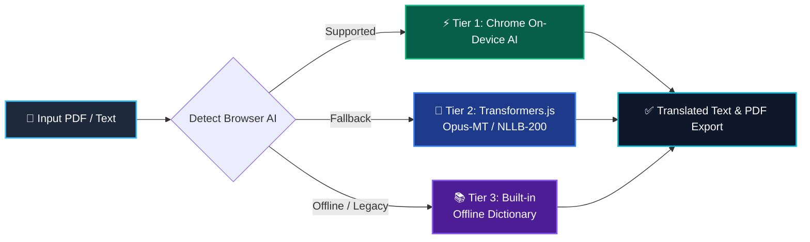

<div align="center">

<!-- Animated Wave Header -->


<!-- Animated Typing SVG -->
<p align="center">
  <a href="https://hexsleuth.github.io/HEXPDF-Translator-PDF-Language-Converter/">
    
  </a>
</p>

<!-- Real-Time GitHub & Status Badges -->
<p align="center">
  <a href="https://hexsleuth.github.io/HEXPDF-Translator-PDF-Language-Converter/">
    
  </a>
  <a href="https://github.com/HexSleuth/HEXPDF-Translator-PDF-Language-Converter/stargazers">
    
  </a>
  <a href="https://github.com/HexSleuth/HEXPDF-Translator-PDF-Language-Converter/network/members">
    
  </a>
  <a href="https://github.com/HexSleuth/HEXPDF-Translator-PDF-Language-Converter/issues">
    
  </a>
</p>

<p align="center">
  
  
  
  
  
</p>

<!-- Quick Action Navigation Pills -->
<p align="center">
  <a href="https://hexsleuth.github.io/HEXPDF-Translator-PDF-Language-Converter/"><strong>🚀 Launch Web App</strong></a> •
  <a href="#-key-features"><strong>✨ Features</strong></a> •
  <a href="#-3-tier-ai-translation-engine"><strong>🧠 AI Architecture</strong></a> •
  <a href="#-quick-start--local-setup"><strong>⚡ Quick Start</strong></a> •
  <a href="#-tech-stack"><strong>🛠️ Tech Stack</strong></a>
</p>

</div>

---

<!-- Animated Divider -->


## 📖 Overview

**HexPDF Studio** is a zero-cost, privacy-first, 100% client-side **PDF Viewer, Bidirectional PDF $\leftrightarrow$ Text Converter, and Neural AI Language Translator** that runs directly inside your web browser.

Unlike traditional online PDF translators that upload sensitive documents to remote cloud servers or require paid API keys, HexPDF Studio processes every page, character, and neural translation **locally on your device**. Whether you are on desktop or mobile, your files never leave your browser.

> **🌐 Live Production App:** [https://hexsleuth.github.io/HEXPDF-Translator-PDF-Language-Converter/](https://hexsleuth.github.io/HEXPDF-Translator-PDF-Language-Converter/)

---

## ✨ Key Features

<table>
  <tr>
    <td width="50%" valign="top">
      <h3>🔒 100% Client-Side & Private</h3>
      <ul>
        <li><strong>Zero Server Uploads:</strong> All parsing, rendering, and translation happen in browser memory.</li>
        <li><strong>No API Keys Required:</strong> Completely free with zero rate limits or subscriptions.</li>
        <li><strong>Offline Capable:</strong> Works offline via built-in fallback dictionaries and cached models.</li>
      </ul>
    </td>
    <td width="50%" valign="top">
      <h3>🧠 Multi-Tier Browser AI Translator</h3>
      <ul>
        <li><strong>Auto-Engine Detection:</strong> Automatically selects the fastest available local AI engine.</li>
        <li><strong>Neural Translation:</strong> Supports Chrome's built-in On-Device AI and WebAssembly/WebGPU models.</li>
        <li><strong>Multi-Language Support:</strong> Translate full documents or individual pages seamlessly.</li>
      </ul>
    </td>
  </tr>
  <tr>
    <td width="50%" valign="top">
      <h3>📄 Interactive PDF Canvas Viewer</h3>
      <ul>
        <li><strong>Drag & Drop Anywhere:</strong> Instant file loading plus a built-in <em>Load Sample PDF</em> mode.</li>
        <li><strong>Smart Scanned PDF Detection:</strong> Automatically flags image-only PDFs with 0 selectable characters.</li>
        <li><strong>Precision Controls:</strong> Smooth page navigation, zoom scaling (default 115%), and source switching.</li>
      </ul>
    </td>
    <td width="50%" valign="top">
      <h3>🔄 Bidirectional PDF $\leftrightarrow$ Text Studio</h3>
      <ul>
        <li><strong>Live Editable Buffer:</strong> Extract text per page or entire document and edit directly in the browser.</li>
        <li><strong>Real-Time Telemetry:</strong> Live counter tracking pages, lines, words, and character counts.</li>
        <li><strong>Custom PDF Generation:</strong> Export edited or translated text back into clean, formatted PDF files.</li>
      </ul>
    </td>
  </tr>
</table>

---

## 🧠 3-Tier AI Translation Engine

HexPDF Studio uses an intelligent **progressive fallback cascade** so translation works across modern desktop browsers, mobile devices, and offline environments:



| Tier | Engine | Execution Environment | Best For |
| :--- | :--- | :--- | :--- |
| **Tier 1** | **Chrome Built-in On-Device AI** | Native Browser Gemini Nano / Translation API | Instant, hardware-accelerated zero-download translation |
| **Tier 2** | **Transformers.js (`Opus-MT` / `NLLB-200`)** | WebAssembly / WebGPU (`@xenova/transformers`) | High-accuracy neural machine translation in any modern browser |
| **Tier 3** | **Offline Dictionary Engine** | Pure JavaScript Local Lexicon | Air-gapped environments, `file://` protocol, and instant word lookup |

---

## 📱 Mobile-Friendly Responsive Workspace

Designed with a fluid, touch-friendly interface that adapts cleanly from widescreen desktop monitors down to smartphones and tablets:

* **Adaptive Split-Pane Workspace:** Side-by-side PDF Canvas Viewer and Live Text Editor on desktop; stacked, thumb-accessible cards on mobile screens.
* **Accessible ARIA Controls:** Screen-reader friendly status announcements (`aria-live`), labeled toolbars, and keyboard-navigable page tabs.
* **Real-Time Progress Bar:** Visual percentage feedback during multi-page text extraction and neural model inference.

---

## 🛠️ Tech Stack

<p align="center">
  
  
  
  
  
  
</p>

* **PDF Rendering & Extraction:** `PDF.js v3.11.174`
* **PDF Generation & Export:** `jsPDF v2.5.1`
* **Client-Side Neural AI:** `@xenova/transformers v2.17.2` (Opus-MT & Meta NLLB-200) + Chrome On-Device AI APIs
* **Hosting:** GitHub Pages (Zero-backend static deployment)

---

## ⚡ Quick Start & Local Setup

### Option 1: Use Online (Recommended)
Simply open **[HexPDF Studio Live](https://hexsleuth.github.io/HEXPDF-Translator-PDF-Language-Converter/)** in any modern browser—no installation needed.

### Option 2: Run Locally
> **Note:** Browser neural AI models (`Transformers.js`) require serving over `http://` or `https://` due to browser WebWorker/CORS security policies. Avoid opening `index.html` directly via `file://` if you want neural AI enabled.

```bash
# 1. Clone the repository
git clone https://github.com/HexSleuth/HEXPDF-Translator-PDF-Language-Converter.git

# 2. Navigate into the project directory
cd HEXPDF-Translator-PDF-Language-Converter

# 3. Start a lightweight local HTTP server
npx serve .
```

Then open `http://localhost:3000` in your browser!

---

## 🎯 How to Use

1. **Load a Document:** Click **Browse PDF File**, drag and drop any PDF onto the window, or click **Load Sample PDF** to test immediately.
2. **Inspect & Edit Text:** View the rendered pages in the **PDF Canvas Viewer** while inspecting or editing extracted text in the **Text Preview & Converter** pane.
3. **Select Languages:** Choose your **Source Language** (or auto-detect) and your **Target Language**.
4. **Translate with Browser AI:** Click **Translate**—HexPDF Studio automatically engages Chrome AI or downloads/caches the neural model locally.
5. **Export Result:** Copy the translated text, download as `.txt`, or generate a brand-new translated `.pdf` file using the built-in **Text to PDF** engine.

---

## 🤝 Contributing

Contributions, feature requests, and bug reports are always welcome!

1. Fork the repository (`https://github.com/HexSleuth/HEXPDF-Translator-PDF-Language-Converter/fork`)
2. Create your feature branch (`git checkout -b feature/AmazingFeature`)
3. Commit your changes (`git commit -m 'Add some AmazingFeature'`)
4. Push to the branch (`git push origin feature/AmazingFeature`)
5. Open a **Pull Request**

---

<div align="center">

<!-- Repository Activity & Contributors -->
<a href="https://github.com/HexSleuth/HEXPDF-Translator-PDF-Language-Converter/graphs/contributors">
  
</a>

<br /><br />

<!-- Animated Wave Footer -->


</div>
